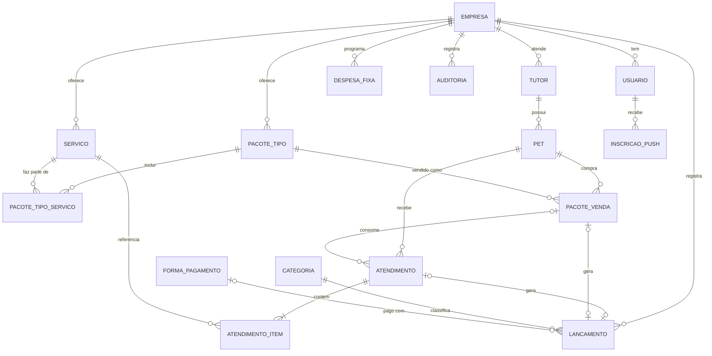
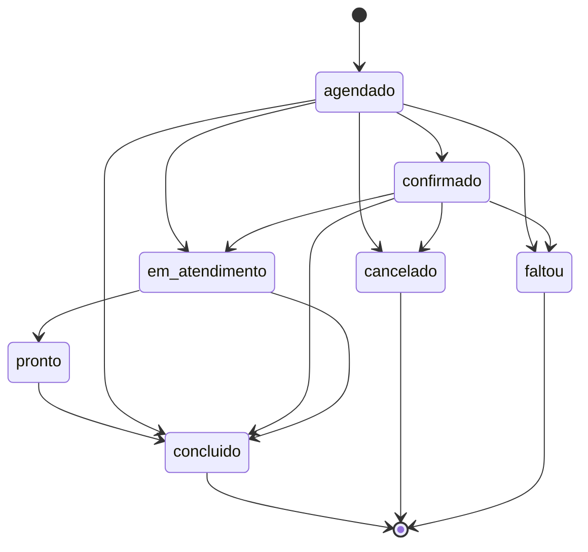
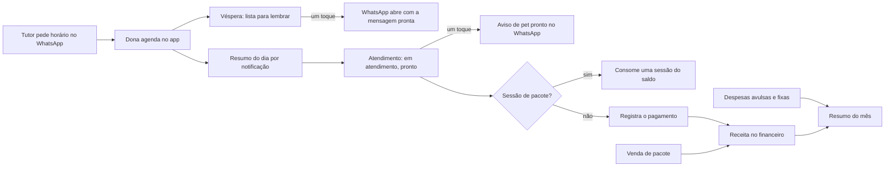

# Sistema de gestão para banho e tosa — Planejamento

Versão 2.7 · 09/11/2026 · Situação: Marco 1 em andamento. Prontos: a base (sessão 01), o login com o painel do administrador (sessão 02), tutores, pets e serviços (sessão 03), a agenda (sessão 04) e concluir o atendimento com pagamento e a receita no dia e no mês (sessão 05). Em andamento: a preparação para produção (sessão 06): imagem, migration na subida, `/api/health`, backup criptografado com restauração testada, CI/CD e documentos de operação (`docs/operacao/`); falta a parte do Victor no EasyPanel, no R2 e no monitor (`docs/operacao/checklist-lancamento.md`). As tabelas estão detalhadas em `docs/planejamento/modelo-de-dados.md`. O Marco 2 depende da pergunta em aberto 1.

## Resumo executivo

- Produto web (SaaS) para pequenos banho e tosa organizarem agenda, pacotes e financeiro. A primeira cliente é a piloto: trabalha sozinha e usa iPhone.
- Resolve três dores: atendimentos esquecidos (hoje a agenda é de memória), pacotes sem controle de saldo e falta de gestão de receitas e despesas.
- O MVP tem tutores e pets, catálogo de serviços e pacotes gerido pela dona, agenda, financeiro da loja, resumo do dia por notificação e lembrete ao tutor com um toque.
- Ficam fora do MVP: integração com o WhatsApp, robô ou IA, cadastro e cobrança automáticos de assinantes e nota fiscal.
- Arquitetura: monolito modular em Next.js com Postgres. Todas as empresas ficam no mesmo banco, isoladas por RLS, na VPS do Victor via EasyPanel.
- Custo extra estimado: cerca de R$ 3,35 por mês no início.
- Pendências que não travam o começo: regras dos pacotes, nome do produto e formalização para vender (antes da 2ª empresa).

## Premissas e perguntas em aberto

**Fatos (decididos)**

- É um produto para vender a outros banho e tosa. A primeira cliente é a piloto.
- Só a dona usa o sistema.
- A dona faz o agendamento. Não haverá robô ou IA no WhatsApp (ADR 0004).
- Não haverá integração com o WhatsApp dela no início.
- Tempo e preço variam com o tamanho do pet e os serviços. Ela gerencia isso numa tela, sem regra automática no início.
- Pacotes citados: mensal, quinzenal e banho com tosa higiênica.
- Financeiro: só gastos e faturamento da loja. Sem nota fiscal.
- O WhatsApp da loja é um número separado do pessoal. Ela usa iPhone.
- Hospedagem na VPS do Victor (ADR 0003).
- Quando houver integração com o WhatsApp, será pela Evolution API (ADR 0006).

**Suposições (valem até alguém dizer o contrário)**

- "Sem robô no WhatsApp" significa nenhuma integração no MVP. Lembrete e aviso de pet pronto saem com um toque, pelo link do WhatsApp (ADR 0005).
- Cada serviço tem preço e duração padrão. Ao agendar, os valores vêm preenchidos e ela ajusta. Tabela de preço por porte fica para depois.
- A primeira entrega segue os marcos da seção 7, já que a pergunta sobre ela não foi respondida.
- Taxa da maquininha: percentual opcional por forma de pagamento, padrão 0%.
- Novas empresas são criadas e cobradas manualmente pelo Victor no início.

**Perguntas em aberto**

1. **Regras dos pacotes.** Para cada pacote: quantas sessões, validade, preço, serviços incluídos e se vale para um pet só. Falta sem aviso gasta a sessão? Sessão não usada vence? "Banho e tosa higiênica" é um terceiro pacote ou o que os pacotes incluem?
   *Sugestão:* pacote por pet, pago na compra. Mensal com 4 sessões e quinzenal com 2, ambos válidos por 30 dias. Falta sem aviso gasta a sessão; desmarcar com 24 h de antecedência devolve.
   *Trava:* Marco 2.
2. **Nome do produto e domínio.**
   *Sugestão:* definir antes de o Marco 1 ir para produção. Até lá, usar um subdomínio do Victor.
   *Trava:* nada no código.
3. **Formalização para vender:** CNPJ, termos de uso, política de privacidade e cláusulas de operador de dados no contrato.
   *Sugestão:* a piloto começa com um contrato simples. O resto fica pronto antes da 2ª empresa.
   *Trava:* Marco 4.

## 1. Problema e escopo

**Dor.** A dona agenda de memória e às vezes esquece uma tosa marcada. Não controla quantas sessões cada cliente ainda tem no pacote. Não sabe quanto entra e quanto sai.

**Para quem.** Donos de pequenos banho e tosa que trabalham sozinhos ou com pouca gente, atendem pelo WhatsApp e usam o celular como ferramenta principal. Piloto: 1 empresa, 1 usuária, iPhone.

**Perfis.**

- **Dona:** usa tudo dentro da própria empresa.
- **Administrador da plataforma (Victor):** cria, suspende e dá suporte às empresas.

**MVP**

- Tutores e pets, com observações de cuidado.
- Catálogo de serviços e de tipos de pacote, gerido pela dona.
- Venda de pacote e saldo de sessões.
- Agenda do dia e da semana, com duração preenchida e aviso de horário ocupado.
- Atendimento acompanhado do agendamento até o pagamento.
- Financeiro: receitas automáticas, despesas avulsas e fixas, resumo do mês e valores a receber.
- Resumo do dia por notificação no celular.
- Lembrete ao tutor e aviso de pet pronto com um toque.
- Exportação dos dados da empresa e anonimização de tutor a pedido.
- Painel do administrador para criar, suspender e reativar empresas.

**Depois**

- Lembretes automáticos pelo WhatsApp (Evolution), com resposta 1 ou 2.
- Cadastro e cobrança automáticos de assinantes, com e-mail transacional.
- Funcionários com perfis próprios, preço por porte, leva e traz, relatórios, sinal via Pix e convite de retorno.

**Não será feito**

- Robô ou IA conversando com tutores.
- Agendamento pelo próprio tutor (link público): a dona quer controlar a agenda.
- Nota fiscal, integração bancária, estoque e folha de pagamento.
- App nativo: o app instalável (PWA) cobre o uso no celular.

**Critério de sucesso (piloto, após 30 dias de uso)**

- Todos os atendimentos do mês passam pela agenda.
- Nenhum atendimento esquecido.
- O fechamento do mês (entrou, saiu, sobrou, a receber) sai do sistema, sem caderno nem planilha.
- Ela agenda um atendimento em menos de 1 minuto no celular.

## 2. Requisitos

### Funcionais

**H1.** Como dona, quero cadastrar tutores e pets para não depender da memória.
Aceite: tutor com nome e telefone, único na empresa. Vários pets por tutor, com espécie, raça, porte e observações (comportamento, alergias). Busca por nome do tutor, nome do pet ou telefone.

**H2.** Como dona, quero gerenciar meu catálogo de serviços para agendar mais rápido.
Aceite: criar, editar e desativar serviços com preço e duração padrão. Serviço desativado some do agendamento, mas continua no histórico.

**H3.** Como dona, quero cadastrar meus tipos de pacote.
Aceite: nome, serviços incluídos, número de sessões, validade em dias, intervalo sugerido entre sessões e preço.

**H4.** Como dona, quero vender um pacote para um pet e acompanhar o saldo.
Aceite: a venda gera uma receita, paga ou a receber. O pet mostra o pacote ativo e o saldo. Alerta quando restar 1 sessão ou faltarem 5 dias para vencer. Pacote que já estava em andamento entra com as sessões já usadas.

**H5.** Como dona, quero agendar escolhendo pet, serviços, dia e hora.
Aceite: duração e preço vêm do catálogo e podem ser editados. Horário ocupado gera aviso, não bloqueio. Se o pet tem pacote ativo, o atendimento já vem vinculado a ele. Dá para agendar todas as sessões do pacote de uma vez, a partir do intervalo sugerido.

**H6.** Como dona, quero ver a agenda do dia e da semana no celular.
Aceite: cada atendimento ocupa um bloco do tamanho da sua duração e mostra pet, serviços, status e observações de cuidado. Atendimentos no mesmo horário ficam lado a lado. Cancelados e faltas saem da grade e ficam numa lista à parte. Na semana, os blocos mostram a ocupação, e tocar num dia abre a agenda desse dia.

**H7.** Como dona, quero acompanhar o atendimento até o fim.
Aceite: status agendado → confirmado → em atendimento → pronto → concluído, ou cancelado e faltou. Ela pode concluir a partir de qualquer status ativo, sem passar por todos. Um toque errado pode ser desfeito: o status volta ao anterior. Reabrir um cancelado ou uma falta também é desfazer: volta a confirmado se o tutor já tinha confirmado, senão a agendado. Concluir um atendimento avulso pede a forma de pagamento. Concluir uma sessão de pacote só consome a sessão.

**H8.** Como dona, quero lembrar o tutor e avisar que o pet está pronto com um toque.
Aceite: lista "lembrar amanhã". O botão abre o WhatsApp com a mensagem pronta para o número do tutor e registra o envio. Ela marca "confirmado" quando o tutor responder.

**H9.** Como dona, quero receber o resumo do dia no celular.
Aceite: notificação no horário configurado (padrão 7h, no fuso da empresa) com a quantidade de atendimentos e o primeiro horário. Tocar abre a agenda do dia. Funciona no iPhone com o app instalado na tela de início.

**H10.** Como dona, quero registrar receitas e despesas e ver o mês.
Aceite: receita automática ao concluir atendimento avulso e ao vender pacote. Despesas com categoria. Despesas fixas lançadas sozinhas no dia do mês configurado. Resumo do mês com entrou, saiu, sobrou e a receber. Lançamento excluído fica no histórico como cancelado.

**H11.** Como dona, quero exportar os dados da minha empresa.
Aceite: arquivos CSV de tutores e pets, atendimentos e lançamentos.

**H12.** Como dona, quero apagar os dados de um tutor que pedir.
Aceite: nome e telefone do tutor são anonimizados. Atendimentos e valores continuam no financeiro, sem identificar a pessoa.

**H13.** Como administrador, quero criar uma empresa e a primeira usuária, e suspender ou reativar empresas.
Aceite: empresa suspensa não consegue entrar, mas os dados são preservados. O administrador redefine senhas. Toda ação dele fica na auditoria.

### Não funcionais

- **Uso:** celular primeiro, com o app instalado na tela de início (PWA). Também funciona no computador.
- **Volume:** a piloto tem dezenas de atendimentos por semana. O produto deve comportar algumas dezenas de empresas na mesma VPS. Carga baixa.
- **Desempenho:** telas principais abrem em menos de 2 s no 4G.
- **Disponibilidade:** sem SLA formal. Meta de 99% no horário comercial. Perda máxima de 24 h de dados (backup diário) e restauração em até 2 h.
- **Segurança:** isolamento entre empresas garantido no banco (RLS), HTTPS e senha com hash.
- **Auditoria:** histórico de alterações no financeiro, nos pacotes e no status dos atendimentos, mais as ações do administrador.
- **LGPD:** ver seção 5.
- **Dados:** valores em centavos (inteiros). Datas guardadas em UTC e exibidas no fuso da empresa, porque o Brasil tem mais de um fuso.

## 3. Domínio e dados

### Entidades e relacionamentos

Toda tabela de negócio tem `empresa_id`. Colunas, restrições e isolamento das tabelas do M1 estão em `docs/planejamento/modelo-de-dados.md`.

| Entidade | Campos principais |
|---|---|
| empresa | nome, fuso_horario, status (ativa, suspensa), horario_resumo (padrão 07:00) |
| usuario (tabela `user` do Better Auth) | empresa_id, nome, email, role (`admin` ou `user`, do plugin admin) |
| tutor | nome, telefone (+55…, único na empresa), observacoes, anonimizado_em |
| pet | tutor_id, nome, especie, raca, porte (P, M, G, GG), observacoes |
| servico | nome, preco_centavos, duracao_min, ativo |
| pacote_tipo | nome, sessoes, validade_dias, intervalo_dias, preco_centavos, ativo; serviços em pacote_tipo_servico |
| pacote_venda | pet_id, pacote_tipo_id, sessoes e preco_centavos copiados na venda, sessoes_usadas_antes, inicio, vence_em, status |
| atendimento | pet_id, inicio, fim, status, pacote_venda_id (opcional), lembrete_enviado_em, confirmado_em, observacoes |
| atendimento_item | servico_id, preco_centavos e duracao_min copiados no agendamento |
| lancamento | tipo (receita, despesa), valor_centavos, taxa_centavos, forma_pagamento_id, categoria_id, data, status, origem (atendimento, pacote, despesa_fixa, manual), motivo_cancelamento |
| forma_pagamento | nome, taxa_percentual (padrão 0) |
| categoria | nome, tipo (receita, despesa) |
| despesa_fixa | descricao, valor_centavos, dia_do_mes, categoria_id, ativa |
| auditoria | usuario_id, entidade, entidade_id, acao, antes e depois (jsonb), quando |
| inscricao_push | usuario_id, endpoint, chaves |

### Regras de negócio

1. Saldo do pacote = sessões vendidas − sessões usadas antes do sistema − atendimentos vinculados concluídos (e faltas, se a regra da pergunta 1 confirmar). É sempre calculado, nunca editado (ADR 0008).
2. A venda do pacote gera a receita. Sessão de pacote não gera receita.
3. Atendimento avulso concluído gera uma receita com a soma dos itens, na forma de pagamento escolhida. "A receber" fica pendente até ela marcar como pago.
4. Preço e duração são copiados do catálogo no agendamento e na venda: mudar o catálogo não altera o passado.
5. Horário sobreposto com outro atendimento gera aviso, não bloqueio. Cancelados e faltas não ocupam horário.
6. Lançamento não é apagado. O cancelamento exige motivo e fica no histórico.
7. Despesa fixa vira lançamento no dia do mês configurado.
8. O pacote fica "vencido" quando passa da validade com saldo e "encerrado" quando o saldo chega a zero.
9. O telefone é guardado no formato internacional (+55…) e é único na empresa.

### Estados

Atendimento:

- **Correção de toque errado:** o atendimento volta ao status anterior, deduzido sem coluna nova (regras no modelo de dados). Reabrir um cancelado ou uma falta é o mesmo que desfazer. Desfazer uma conclusão cancela a receita com motivo e volta ao status de antes de concluir. Toda mudança fica na auditoria.
- **Pacote vendido:** ativo → encerrado (saldo zero), vencido (passou da validade) ou cancelado.
- **Lançamento:** a receber → pago. Qualquer um → cancelado, com motivo. Cancelado é final: o banco recusa qualquer mudança numa linha cancelada (trigger). Concluir de novo cria outra receita.
- **Índice da receita do atendimento:** o índice único parcial em `lancamento(atendimento_id)` (não cancelados) fica sem `empresa_id`. Ele é mais restritivo que um índice com a empresa, porque os uuids são globais e a chave estrangeira composta já prende o atendimento à empresa. As consultas filtram por `atendimento_id`, e o RLS acrescenta a empresa. Um erro de duplicidade só revelaria algo de outra empresa a quem já soubesse o uuid de um atendimento dela, e o app sempre lê o atendimento pelo RLS ("não encontrado") antes de criar a receita. Sem motivo concreto para mudar (revisado na sessão 06).

### Dono dos dados

- Tutores, pets, atendimentos e financeiro pertencem a cada empresa. A dona digita e só ela altera.
- O administrador não altera dados de negócio. Quando precisa acessar para suporte, o acesso fica na auditoria.
- Não há sistema de origem nem importação no MVP: o cadastro cresce a cada atendimento.

## 4. Arquitetura

**Estilo.** Monolito modular: um app Next.js dividido em módulos (empresas e acesso, cadastros, catálogo, agenda, pacotes, financeiro, notificações, administração). Cada módulo é dono das suas tabelas e expõe funções de serviço para os outros.

**Stack**

| Peça | Escolha | Por quê | Descartada |
|---|---|---|---|
| App (telas e API) | Next.js com TypeScript | uma base só e já faz parte da stack do Victor | Next.js e Fastify separados: dois deploys sem ganho nesse volume |
| Banco | Postgres | RLS para isolar empresas e fila de tarefas no mesmo banco | MySQL: não tem RLS |
| Acesso ao banco | Drizzle ORM | SQL explícito e transação por requisição simples, que o RLS exige | Prisma: o RLS exige extensão e transação em toda consulta |
| Login | Better Auth, com e-mail e senha | biblioteca ativa; a equipe também mantém o Auth.js e recomenda Better Auth para projetos novos | Auth.js; login feito à mão |
| Tarefas agendadas | pg-boss (fila no Postgres) | nada novo para operar, com nova tentativa e histórico | n8n: regra dividida em dois lugares; cron solto: sem nova tentativa |
| Notificações | Web Push no app instalado (PWA), chaves VAPID | grátis e funciona no iPhone com o app na tela de início | e-mail: pouco lido; WhatsApp: fora do MVP |
| Hospedagem | EasyPanel na VPS do Victor | já existe, custo marginal perto de zero | VPS dedicada: custo sem necessidade agora |

**Multiempresa (ADR 0002)**

- Banco único com `empresa_id` em toda tabela de negócio e uma política de RLS que compara `empresa_id` com a empresa da transação, na leitura e na escrita. A expressão exata, os papéis do banco e o teste de isolamento estão no modelo de dados.
- Cada requisição abre uma transação, define `app.empresa_id` a partir da sessão com `set_config(..., true)` e roda as consultas dentro dela.
- O app conecta com um usuário do banco que não é dono das tabelas, não é superusuário e não tem `BYPASSRLS`. Migrations usam outro usuário.
- O painel do administrador e as tarefas que passam por todas as empresas usam uma conexão própria. Toda ação do administrador vai para a auditoria.

**Integrações**

- **WhatsApp no MVP (ADR 0005):** sem API. O app monta `https://wa.me/<telefone>?text=<mensagem>` e abre o WhatsApp no celular dela com a mensagem pronta. Não há contrato, custo nem risco de banimento.
  Ponto de atenção: num iPhone com WhatsApp e WhatsApp Business, o link abre primeiro o WhatsApp pessoal, que oferece "Abrir no WhatsApp Business" ([Privyr](https://help.privyr.com/knowledge-base/whatsapp-vs-whatsapp-business/)). Testar no aparelho dela.
- **Web Push (ADR 0009):** o servidor envia pelo serviço de push da Apple ou do Google, autenticado com chaves VAPID.
  Falha: a fila tenta de novo. Inscrição expirada (resposta 404 ou 410) é removida e o app pede para reativar. O resumo também aparece ao abrir o app, então uma notificação perdida não esconde nada.
- **Futuro, Evolution API (ADR 0006):** REST e webhook, uma instância por empresa. O envio passa pela fila com chave de idempotência por lembrete e nova tentativa com espera. O status da conexão é monitorado e o reenvio manual fica no painel.

**Fluxo principal**

**Decisões registradas**

| ADR | Decisão | Status |
|---|---|---|
| 0001 | Monolito modular em Next.js com Postgres | aceito |
| 0002 | Multiempresa com banco compartilhado e RLS | aceito |
| 0003 | Hospedagem na VPS do Victor com EasyPanel | aceito |
| 0004 | Agendamento feito pela dona, sem robô ou IA | aceito |
| 0005 | MVP sem integração com o WhatsApp: lembrete com um toque | aceito |
| 0006 | Evolution API para a integração futura com o WhatsApp | aceito, adiado |
| 0007 | Tarefas agendadas no Postgres com pg-boss, sem n8n | aceito |
| 0008 | Trilha de auditoria: saldo calculado e lançamentos sem exclusão | aceito |
| 0009 | Notificações da dona por Web Push no app instalado | aceito |
| 0010 | Login com e-mail e senha usando Better Auth | aceito |
| 0011 | Auditoria das ações de login fora da transação | aceito |
| 0012 | Dados padrão da empresa criados por trigger com SECURITY DEFINER | aceito |
| 0013 | Backup diário criptografado com age, enviado ao Cloudflare R2 | aceito |
| 0014 | Deploy por imagem no GHCR com gatilho do EasyPanel e migration na subida do container | aceito |

## 5. Segurança e acesso

**Autenticação (ADR 0010).** E-mail e senha via Better Auth, sessão em cookie httpOnly e seguro, limite de tentativas de login. Não há e-mail transacional no MVP, então o administrador redefine senhas.

**Perfis**

| Perfil | Pode |
|---|---|
| Dona | tudo dentro da própria empresa |
| Administrador da plataforma | criar, suspender e reativar empresas; criar usuária e redefinir senha. Não vê dados de negócio no uso normal |

Funcionário fica para depois.

**Isolamento.** RLS em toda tabela de negócio. Cada módulo tem um teste automatizado que tenta ler dados de outra empresa; se vazar, o build falha.

**Secrets.** Só em variáveis de ambiente do EasyPanel: conexões do app e da migration, segredo do Better Auth, chaves VAPID e credenciais do backup. Nada no repositório; o `.env.example` vai sem valores.

**Auditoria (ADR 0008).** Gravada na mesma transação da alteração, para lançamentos, vendas de pacote, status de atendimento e ações do administrador. Fica guardada enquanto a empresa existir.

**Backup (ADR 0013).** `pg_dump` diário, compactado e criptografado com `age`, enviado para um bucket no Cloudflare R2, com 30 dias de retenção.

- Só a chave pública fica na VPS; a privada fica com o Victor, com uma segunda cópia fora do computador e do gerenciador de senhas.
- O dump é feito por um papel só de leitura (`backup`).
- O script só apaga o que passou de 31 dias depois de um envio bem-sucedido, e uma trava de 30 dias no bucket impede apagar antes.
- Restauração testada num banco separado antes do lançamento e depois uma vez por mês, e automaticamente no CI (`npm run test:backup`), com o isolamento conferido depois de restaurar.

**LGPD**

| Dado | De quem | Base legal (da empresa) | Retenção |
|---|---|---|---|
| Nome e telefone do tutor | clientes de cada banho e tosa | execução do serviço contratado | enquanto for cliente; anonimizado a pedido (H12) |
| Observações do pet | ligadas ao tutor | execução do serviço contratado | junto com o tutor |
| Nome e e-mail da usuária | assinante | execução do contrato de assinatura | enquanto assinante, mais 90 dias |

- **Papéis:** cada banho e tosa é controlador dos dados dos seus clientes. O Victor (ou a empresa dele) é operador desses dados e controlador dos dados de cadastro dos assinantes.
- **Documentos antes da 2ª empresa:** termos de uso, política de privacidade e cláusulas de operador no contrato.
- **Pontos de exposição:**
  - app na internet: HTTPS e login;
  - backups: criptografados;
  - logs: sem nome nem telefone (erros do banco viram só código, restrição, tabela e empresa);
  - notificação na tela bloqueada: só nome do pet e horário, sem dados do tutor.
- **Fim da assinatura:** 90 dias para exportar os dados e depois exclusão. Os backups expiram em 30 dias.

## 6. Infraestrutura e operação

**Ambientes**

- **Desenvolvimento:** local, com Postgres em Docker.
- **Homologação:** projeto separado no EasyPanel, com banco próprio e dados fictícios.
- **Produção:** EasyPanel na VPS do Victor.

**Deploy e CI**

1. Código no GitHub.
2. O GitHub Actions roda lint, checagem de tipos e testes (incluindo os de isolamento), o ponta a ponta (também às 23:50 e às 00:10, com o servidor em UTC), o teste da imagem e o teste do backup.
3. Cada push na main, com tudo verde, publica a imagem no GitHub Container Registry (tag imutável `sha-<commit>` e etiqueta `homologacao`) e chama o gatilho de deploy do EasyPanel da homologação (ADR 0014).
4. Produção sobe por tag `v*`, com aprovação manual no GitHub: a mesma imagem já testada ganha a etiqueta `producao`, sem build novo.
5. A migration roda na subida do container, como `migrador`, antes de o servidor novo entrar. Se falhar, o container novo não sobe e a versão anterior continua no ar.
6. Toda migration é compatível com a versão anterior do app. Voltar uma versão é trocar a imagem, nunca restaurar o banco.
7. Passo a passo de operação em `docs/operacao/README.md`.

**Convivência na VPS (ADR 0003)**

- Postgres próprio do produto, separado dos bancos de outros projetos.
- Limite de memória e CPU por serviço, para que outro projeto não derrube o produto.
- Mudar o produto para uma VPS só dele quando a receita das assinaturas pagar essa VPS, ou antes se o uso de memória ficar acima de 70% com frequência.

**Monitoramento e alertas**

- Rota `/api/health` (app e banco, sem autenticação e sem dados) checada por um monitor externo, fora da VPS, para não cair junto com ela. Sugestão: UptimeRobot para a rota e Healthchecks.io para o heartbeat do backup, cujos planos gratuitos permitem uso comercial (termos conferidos em 09/11/2026; links no checklist de lançamento).
- Alertas por e-mail ou Telegram para: app fora do ar, backup que falhou e tarefa da fila que falhou depois das novas tentativas.
- Logs do container no EasyPanel, sem dados pessoais. Os erros levam o identificador da empresa.

**Custo mensal estimado**

| Item | Custo |
|---|---|
| VPS | já paga; custo marginal perto de zero até algumas dezenas de empresas |
| Domínio .com.br | R$ 40 por ano, cerca de R$ 3,35 por mês ([Registro.br](https://registro.br/)) |
| Backup no Cloudflare R2 | grátis até 10 GB por mês; depois US$ 0,015 por GB, sem custo de saída ([R2](https://developers.cloudflare.com/r2/pricing/)) |
| Web Push e link do WhatsApp | grátis |
| Monitor externo | plano gratuito |
| **Total extra** | **cerca de R$ 3,35 por mês** |

## 7. Entrega (marcos, riscos, testes)

### Marcos

Cada marco termina em produção e em uso pela piloto.

- **M1. Fluxo mínimo ponta a ponta.**
  - Escopo: base multiempresa (empresa, login, RLS e testes de isolamento), tutores e pets, catálogo de serviços, agenda do dia e da semana, conclusão do atendimento com pagamento e receita no resumo do mês. Deploy com backup e monitor funcionando.
  - Pronto quando: ela agenda, atende e vê a receita do dia no iPhone, com o app na tela de início.
- **M2. Pacotes.**
  - Escopo: tipos de pacote, venda, saldo, agendamento em série, alertas de fim de pacote e entrada dos pacotes em andamento.
  - Depende da pergunta 1.
  - Pronto quando: todos os pacotes ativos dela estão no sistema com o saldo certo.
- **M3. Financeiro completo e lembretes.**
  - Escopo: despesas avulsas e fixas, categorias, a receber, taxa da maquininha, lembrete e aviso de pet pronto com um toque, resumo do dia por notificação.
  - Pronto quando: o fechamento do mês sai do sistema e ela recebe o resumo na hora configurada.
- **M4. Pronto para a 2ª empresa.**
  - Escopo: painel do administrador, exportação em CSV, anonimização de tutor, termos e política de privacidade, roteiro de implantação.
  - Pronto quando: uma empresa nova é criada e começa a usar em menos de 30 minutos, sem mexer no código.
- **Depois:** WhatsApp via Evolution, cadastro e cobrança automáticos, funcionários, preço por porte e leva e traz.

### Riscos

| Risco | Mitigação |
|---|---|
| As regras dos pacotes mudarem o modelo | O M1 não depende de pacotes. Fechar a pergunta 1 antes do M2. |
| Dados vazarem entre empresas | RLS no banco e testes de isolamento obrigatórios no CI. |
| Outro serviço derrubar o produto, ou a VPS cair | Limites de recursos, banco próprio, backup fora da VPS, monitor externo e plano de mudança. |
| Ela voltar ao caderno se o app for lento no celular | Telas pensadas para o iPhone e meta de agendar em menos de 1 minuto. Acompanhar a primeira semana de uso. |
| Notificação no iPhone exige o app na tela de início e a permissão concedida | Instalar junto com ela na entrega. O resumo também aparece ao abrir o app. |
| O link do WhatsApp abrir o app pessoal no iPhone com os dois WhatsApps | Testar no aparelho dela no M3. O WhatsApp oferece "Abrir no WhatsApp Business". |
| O escopo de produto crescer antes da hora (cobrança, cadastro self-service) | Manual até a 3ª a 5ª empresa. |
| Vender sem formalização (CNPJ, termos, LGPD) | Resolver antes da 2ª empresa. |
| Uma pessoa só para manter tudo | Backups testados, README de operação e deploy automatizado. |
| Disputa sobre quem é dono do código | Desenvolver só com computador, contas e horário próprios, sem recursos de nenhum empregador. É a condição da Lei do Software (Lei 9.609/1998, art. 4º, § 2º) para o programa ser de quem o criou. Conferir também o contrato de trabalho. |

### Dependências

- **Antes de codar:** computador, conta no GitHub e repositório privado próprios (ver riscos), com Node e Docker instalados.
- **Antes de o M1 ir para produção:**
  - nome do produto e domínio (pergunta 2);
  - Postgres do produto no EasyPanel, em homologação e produção, com os três usuários do banco. Usar a versão 18, a mesma do desenvolvimento e do CI: a busca depende da extensão `unaccent`, criada pelo `migrador` como dono do banco;
  - bucket do backup no Cloudflare R2 e monitor externo configurados;
  - acordo simples com a piloto, cobrindo o tratamento dos dados dos clientes dela, antes de ela cadastrar clientes reais;
  - lista de serviços da piloto, com preço e duração, para o catálogo e os testes;
  - `BETTER_AUTH_URL` com https em homologação e produção, porque o app não sobe sem isso;
  - `BETTER_AUTH_TRUSTED_PROXIES` apontando para o proxy do EasyPanel. Sem isso, cinco senhas erradas de qualquer pessoa bloqueiam o login de todas por um minuto. O app não sobe sem ela em homologação e produção;
  - os passos do Victor em `docs/operacao/checklist-lancamento.md` (Postgres, usuários do banco, variáveis, R2, chave do backup, monitor, teste de restauração e acordo com a piloto).
- **Resolvido na sessão 06:**
  - o `criar-admin` roda dentro da imagem de produção, empacotado no build (`node dist/criar-admin.mjs`, ADR 0014);
  - a mesma versão do Node em desenvolvimento, CI e produção: Node 26, LTS com suporte até 30/04/2029 ([endoflife.date](https://endoflife.date/nodejs)), adotado depois de o CI passar inteiro com ele (`.nvmrc`). O Node 22 perde suporte em 30/04/2027.
- **Antes do M2:** regras dos pacotes (pergunta 1).
- **Antes da 2ª empresa:** CNPJ, termos de uso e política de privacidade (pergunta 3).

### Testes

- **Unitários:** saldo de pacote, geração de receitas, transições de status, despesas fixas e fuso horário.
- **Integração:** isolamento entre empresas em cada módulo, obrigatório no CI.
- **Ponta a ponta (Playwright, em tela de iPhone):**
  - agendar → concluir → ver no financeiro;
  - vender pacote → consumir sessão.
- **Backup:** restauração antes do lançamento e depois uma vez por mês.
- **Piloto:** na primeira semana ela usa o app junto com o jeito atual, e vocês comparam no fim da semana.

### Migração

Não há sistema anterior: a agenda é de memória, e o cadastro cresce a cada atendimento. Os pacotes em andamento entram no M2, cada um com as sessões que o pet já usou.

## Checklist "pronto para codar"

- [x] Problema, público e critério de sucesso estão escritos.
- [x] O escopo do MVP e a lista do que fica de fora estão definidos.
- [ ] As entidades, estados e regras de negócio principais estão descritos. **Parcial:** faltam as regras dos pacotes (pergunta 1), o que não bloqueia o M1.
- [x] Cada integração tem contrato, autenticação e tratamento de falha definidos. No MVP são o link do WhatsApp e o Web Push; a Evolution está descrita para depois.
- [x] Autenticação, permissões, auditoria e pontos de LGPD estão decididos. Os documentos legais ficam para antes da 2ª empresa.
- [x] Existe plano de deploy, backup e monitoramento, com custo estimado.
- [x] Os marcos de entrega, riscos e estratégia de testes estão listados.
- [x] Toda decisão relevante tem um ADR (0001 a 0014).

**Conclusão:** pronto para codar o M1. O M2 espera a resposta da pergunta 1.
